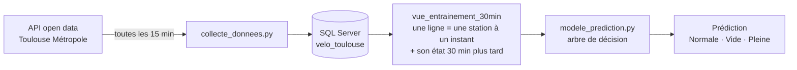

# VélôToulouse : prédire les stations vides ou pleines

Ce projet prédit, pour chaque station VélôToulouse, si elle sera **vide**, **pleine** ou **normale** dans 30 minutes, à partir de l'heure, du jour et de son remplissage actuel.

Il couvre toute la chaîne de la donnée : collecte automatique depuis l'API open data de Toulouse Métropole, stockage dans SQL Server, préparation en SQL, puis modèle de machine learning en Python.

## Résultats

Premier modèle : un arbre de décision, évalué sur 63 375 situations jamais vues pendant l'entraînement (28 au 30 octobre 2026).

| Indicateur | Modèle | Prédiction naïve* |
| --- | ---: | ---: |
| Bonnes prédictions (accuracy) | **83 %** | 63 % |
| Stations qui vont se vider, détectées (rappel « Vide ») | **79 %** | 0 % |
| Stations qui vont être pleines, détectées (rappel « Pleine ») | **69 %** | 0 % |

\* La prédiction naïve répond toujours « Normale ». Elle a souvent raison, puisque c'est l'état le plus fréquent, mais ne prévient jamais d'une station vide ou pleine. C'est pourquoi le modèle est jugé sur le **rappel par état**, et pas seulement sur le taux de bonnes prédictions.

## Fonctionnement



### 1. Collecte

`collecte_donnees.py` interroge deux jeux de données de l'API : les caractéristiques des stations et leur disponibilité en temps réel.

- Les 466 stations sont enregistrées une fois dans la table `stations` ; les nouvelles sont ajoutées automatiquement.
- À chaque passage, une mesure par station est ajoutée dans `historique_velos` : vélos disponibles, places libres, vélos et bornes hors service, location et dépôt possibles.
- L'API renvoie environ 3 000 enregistrements pour 466 stations, avec des doublons. Le script ne garde qu'une mesure par station.
- Les dates sont stockées en UTC. La collecte est lancée toutes les 15 minutes par le Planificateur de tâches Windows.

### 2. Préparation en SQL

La vue `vue_entrainement_30min` construit la table d'entraînement.

- La table `historique_velos` est jointe à elle-même : pour chaque mesure, on cherche la mesure de la même station **25 à 35 minutes plus tard**, pour tolérer les petits décalages de la collecte.
- L'état futur est calculé à partir du taux de remplissage (vélos disponibles ÷ capacité) :

| Taux de remplissage dans 30 min | État |
| --- | --- |
| moins de 15 % | Vide |
| plus de 85 % | Pleine |
| entre les deux | Normale |

- Les dates sont converties en heure de Paris, pour que l'heure et le jour correspondent aux habitudes des usagers.
- Les colonnes mesurées 30 minutes plus tard ne sont pas exposées : le modèle lirait directement la réponse au lieu de l'apprendre (**fuite de données**).
- Les 12 stations sans capacité connue sont exclues.

Une vue se recalcule à chaque lecture : les nouvelles collectes sont prises en compte sans rien relancer.

### 3. Modèle

`modele_prediction.py` lit la vue, entraîne le modèle et l'évalue.

**Variables utilisées**

| Variable | Rôle |
| --- | --- |
| `heure_locale` | heure de la mesure (heures de pointe) |
| `jour_semaine` | jour de la semaine |
| `station_id` | chaque station a son propre comportement |
| `velos_disponibles` | situation actuelle |
| `taux_de_remplissage_actuel` | situation actuelle, rapportée à la taille de la station |

Les dates précises sont écartées, car elles ne se reproduisent pas ; la capacité aussi, car elle se déduit des vélos disponibles et du taux de remplissage.

**Choix de méthode**

- **Découpage dans le temps** : entraînement sur les mesures avant le 28 octobre (≈ 70 %), test sur la suite (≈ 30 %). Un tirage au hasard aurait mélangé des moments presque identiques entre les deux jeux et donné un score trop optimiste.
- **Arbre de décision** limité à 5 niveaux (`max_depth=5`), pour éviter qu'il apprenne par cœur les cas particuliers.
- **Évaluation** par `accuracy_score` et `classification_report` (précision, rappel et f1 par état), comparés à la prédiction naïve.

## Contenu du dépôt

| Fichier | Rôle |
| --- | --- |
| `collecte_donnees.py` | collecte API → SQL Server |
| `sql/creation_tables.sql` | création des tables `stations` et `historique_velos` |
| `sql/vue_entrainement_30_min.sql` | création de la vue d'entraînement |
| `modele_prediction.py` | chargement, séparation dans le temps, entraînement et évaluation |

## Lancer le projet

**Prérequis** : Windows, SQL Server en local avec une base `velo_toulouse`, ODBC Driver 18 for SQL Server, Python 3.

```bash
python -m pip install pandas pyodbc requests scikit-learn
```

1. Exécuter `sql/creation_tables.sql` dans SSMS.
2. Lancer `python collecte_donnees.py`, puis le programmer toutes les 15 minutes (Planificateur de tâches Windows).
3. Une fois quelques jours de données collectés, exécuter `sql/vue_entrainement_30_min.sql`.
4. Lancer `python modele_prediction.py`.

La connexion utilise l'authentification Windows : aucun mot de passe n'est stocké dans le code.

## Données

- **Source** : [données ouvertes de Toulouse Métropole](https://data.toulouse-metropole.fr), jeux « VélôToulouse – localisation et caractéristiques des stations » et « VélôToulouse – disponibilité temps réel ».
- **Période analysée** : du 21 au 30 octobre 2026, soit environ 200 000 situations sur 485 passages de collecte.
- **Répartition des états** : 61 % Normale, 31 % Vide, 8 % Pleine.

## Limites

- **Collecte locale** : elle s'arrête quand l'ordinateur est éteint ou en veille, d'où 485 passages au lieu d'environ 870 attendus sur la période. Certaines heures, notamment la nuit, sont moins représentées.
- **Historique court** : un peu plus d'une semaine, donc chaque jour de la semaine n'apparaît qu'une ou deux fois.
- **État « Pleine » rare** (8 % des cas), donc moins bien prédit.
- La collecte continue : les résultats évoluent à chaque exécution du modèle, qui gagnera en précision avec plus de données.

## Prochaines étapes

- Tester d'autres modèles, comme une forêt aléatoire, et comparer leurs rappels.
- Ajouter la météo comme variable.
- Construire un tableau de bord Power BI branché sur la base SQL Server.

## Autrice

**Blessing TOSSOU** · Étudiante en L3 MIAGE, Université Toulouse Capitole

Python · SQL · Power BI · R

[LinkedIn](https://www.linkedin.com/in/blessing-tossou-992775342/)
